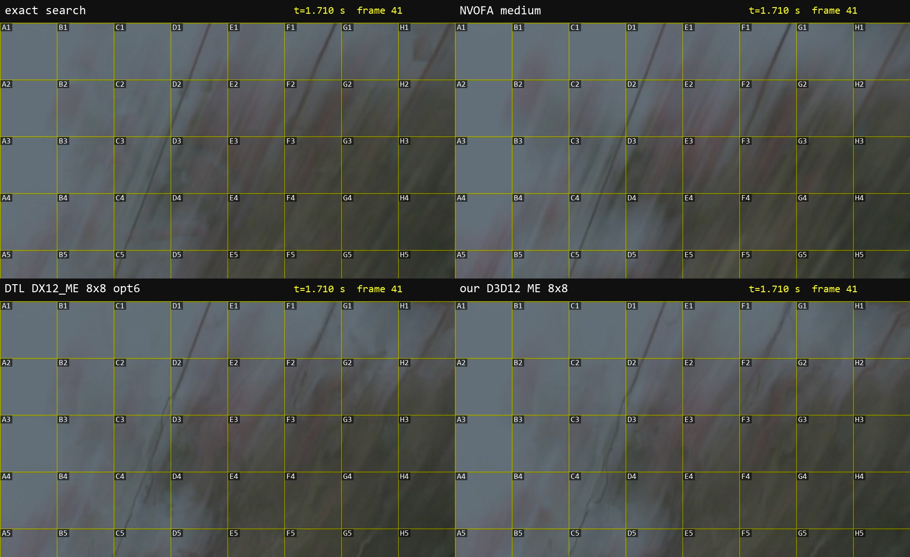
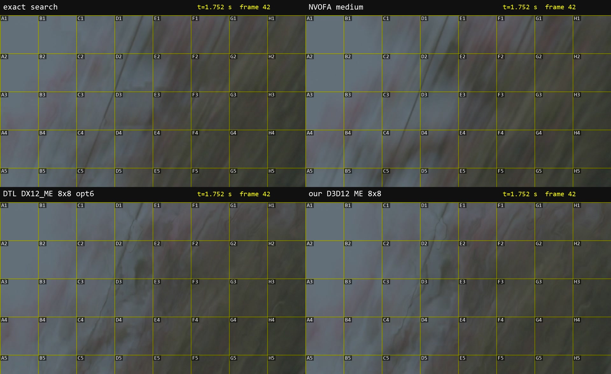
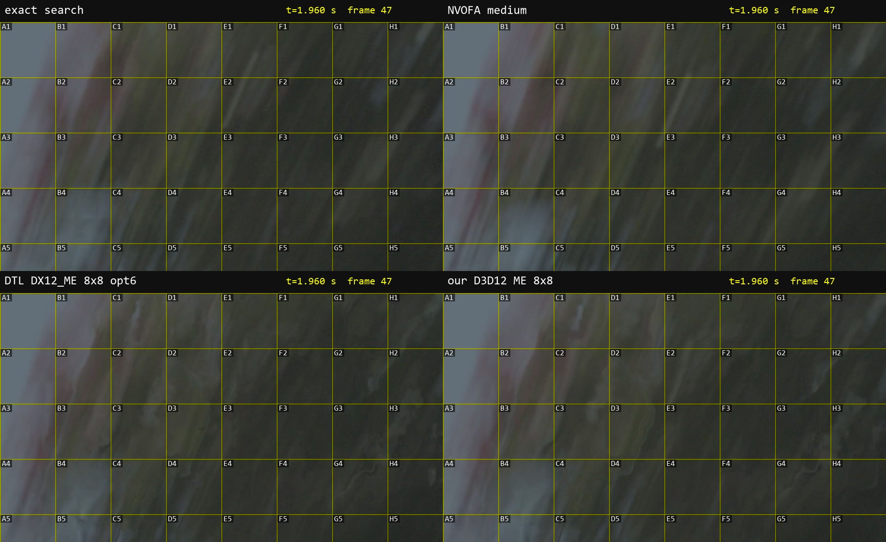
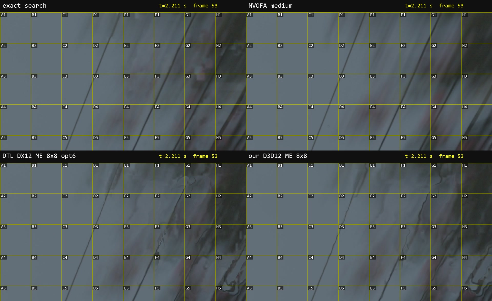

# uc_FRC with DTL's own DX12_ME build (unchanged) vs our variants

> **Status 2026-10-31: DTL's DX12_ME MAnalyse is not better than our D3D12 reimplementation: it gives the same
> vectors.** With the same block layout our prototype scores the same as his build (8x8: 0.1068 vs 0.1067). Our
> prototype's better 0.058 comes from what it does with the engine field afterwards: the median of the 8x8 cells under
> each 32/16 block. Both stay far behind NVOFA medium (0.009) and behind the exact search (0.047) on this 8-bit input.
> Not judged by eye yet; preview frames of the tree section in [For the visual check](#for-the-visual-check).
> Problems found in his build (for DTL): [Notes for DTL](#notes-for-dtl).

The next step of [NVENCMEAnalyse.md](../../NVENCMEAnalyse.md) ("Prototype results and next step"): DTL2020's own
build of the D3D12 video motion estimator path (`optSearchOption=5 / 6`), unchanged, in the uc_FRC chain of
[compare/nvofa_frc](../nvofa_frc/), against our references and our reimplementation
([compare/nvencme_frc](../nvencme_frc/), `NVENCMEProto(dx12=8)`).

## Setup

- **His build**: release `r.2.7.46-a.29` (2024-04-15) of DTL2020/mvtools, `Release_150424.zip`, `DX12/AVX2/mvtools2.dll`
  (sha256 c1635a54…870c) + `Compute.cso` (2a08d2a0…1e9c), in `profile\dtl_dx12`. Never loaded in the same script as our
  mvtools2.dll. Source of the tag (74b414d) read for the checks below, not built.
- **Input**: seg1_wires_pole.mp4 (UHD 10-bit 4:2:2) through `ConvertBits(8).ConvertToYV12()`, because his DX12 path
  takes YV12 only (`MVAnalyse.cpp:253`). All variants, references included, run on this input, so the md5s and scores
  are not those of the 10-bit tables in the other READMEs.
- **Chain**: as `frc_flow.avs`: analysis on `RemoveGrain(22)`, MRecalculate 16/8 `thSAD=100, search=3, searchparam=2,
  truemotion=true, chroma=true` on a pel-2 super, MFlowFps 24000/1001 `mask=2, ml=200`, `Trim(8, 247)`, `Prefetch(3)`.
  In his DLL the whole chain is his (MSuper / MAnalyse / MRecalculate / MFlowFps; his MRecalculate and MFlowFps take no
  `gpu` / `mt`). His DX12 search exactly as his call:
  ```avisynth
  supa = MSuper(pre, mt=false, pel=4, pelrefine=false, chroma=true, levels=1)
  bv = MAnalyse(supa, blksize=8, isb=true, delta=1, chroma=true, optSearchOption=5, levels=1)   # and isb=false
  ```
  Scripts: [scripts/variants.py](scripts/variants.py) (all variants), [scripts/render.py](scripts/render.py),
  [scripts/prescreen.py](scripts/prescreen.py), [scripts/slowmo.py](scripts/slowmo.py).
- RTX 5090, driver 616.92.

### What his build needs and does (checked before scoring)

- **UHD works**: his notes mention only 1920x1080 tests; his size check takes the engine's range (32..4096 here), and
  3840x2160 runs. No 1080p fallback needed.
- **`Compute.cso` is read from the current directory** of the process (`DX::ReadData(L"Compute.cso")`,
  `MVAnalyse.cpp:2204`), not from the DLL's folder; without it MAnalyse stops with a clean error ("Can not load file
  Compute.cso"). The scripts run ffmpeg in a folder holding a copy (`variants.run_dir`).
- **optSearchOption=6 with his MSuper** (pel 4, `pelrefine=false`) is refused unless `UseSubShift=1`
  (`MVAnalyse.cpp:210`); the =6 variants add it. =5 and =6 take the same engine vectors (99.4 % of the 8x8 blocks
  identical in the raw MAnalyse output); they differ in the SAD only (shader vs CPU), which MRecalculate recomputes.
- **optSearchOption=5 crashes when multithreaded**: under `Prefetch(3)` 8 of 12 runs stopped with "MFlowFps: error in
  frame 9..65: Previous GetFrame did not finished properly. There was a crash" (ffmpeg still exits with 0). His filters
  are `MT_MULTI_INSTANCE`, so each thread has its own MAnalyse and its own D3D12 device: the crash is in the
  shader-SAD path with several devices / queues at once, not from sharing an instance. =6 never failed. Single-threaded
  =5 runs and is deterministic (`Prefetch(1)` and no Prefetch: same md5), so the =5 variants run with `Prefetch(1)`.
  Nothing hung; every run has a timeout.
- **Vectors are right**: a synthetic clip with a different shift per frame pair gives exactly the expected vectors for
  every pair in both directions (no frame lag). All-zero fields only where expected (fv 0 and bv 149: no reference)
  and at fv 1, where the clip is static (our exact search and our prototype give zero there too).
- **Vector clip layout = ours**: same `ClipFnc::format_vector_clip`, same MVAnalysisData field order, header 256 bytes.
  prescreen.py checks every frame of every variant (headerSize, block size 16, overlap 8, pel 2, 479 x 269 blocks,
  data size); all passed.

## Vectors (`scripts/prescreen.py`, MRecalculate output, score as in nvofa_frc)

| variant | score all | score tree | mean SAD | cells > 0.5 |
|---|---:|---:|---:|---:|
| exact search (ours) | 0.047 | 0.035 | 316 | 173 |
| **NVOFA medium** (ours) | **0.009** | **0.011** | 199 | 3 |
| our D3D12 ME 8x8 (32/16 blocks, median of the cells) | 0.058 | 0.115 | 247 | 2097 |
| our D3D12 ME 16x16 (32/16 blocks) | 0.088 | 0.154 | 241 | 2699 |
| DTL CPU search (his DLL, uc_FRC MAnalyse 32/16) | 0.051 | 0.050 | 313 | 93 |
| DTL DX12_ME opt5 8x8 | 0.107 | 0.186 | 233 | 3788 |
| DTL DX12_ME opt5 16x16 | 0.146 | 0.225 | 209 | 3599 |
| DTL DX12_ME opt6 8x8 | 0.106 | 0.186 | 234 | 3783 |
| DTL DX12_ME opt6 16x16 | 0.145 | 0.224 | 210 | 3590 |
| *our D3D12 ME 8x8, blocks 8/0 (his layout)* | *0.107* | *0.186* | *233* | *3784* |
| *our D3D12 ME 16x16, blocks 16/0 (his layout)* | *0.147* | *0.227* | *208* | *3610* |

SADs are about 1/4 of the 10-bit tables (8-bit input). The references barely move from the 10-bit run (exact 0.038 →
0.047, NVOFA 0.009 → 0.009, our D3D12 8x8 0.059 → 0.058).

**Why his build scores worse than our prototype**: not his settings, pel 4 or his SAD shader. Our prototype run with
his block layout (one engine cell per block, 8/0 or 16/0, straight into MRecalculate 16/8; last two rows) matches his
scores to the third decimal. The engine field is the same through both implementations. Our 0.058 comes from the
prototype's MAnalyse-shaped output: per 32x32 block (overlap 16) the median of the 16 engine cells under it, a spatial
smoothing that removes much of the per-block jumping. pel 4 brings nothing, because his DX12 path uploads the
integer-pel plane (`pSrcGOF->GetFrame(0)`) and passes the engine's quarter-pel vectors through 1:1. The SAD path
(=5 vs =6) changes the score by 0.0003. 16x16 is worse than 8x8 in both implementations.

His CPU search differs from our exact search (other md5, 0.051 vs 0.047; his fork has its own MAnalyse changes); it
is not part of the question here.

## Speed (112 output frames, `scripts/render.py`, best of 3, indicative)

| variant | wall | md5 (ffmpeg -f md5, same in 2 runs) |
|---|---:|---|
| exact search | 4.83 s | 1E84881F931C |
| NVOFA medium | 3.99 s | 4806EECABA78 |
| our D3D12 ME 8x8 | 6.05 s | B86701F61101 |
| our D3D12 ME 16x16 | 5.76 s | FF7F59FBC957 |
| DTL CPU search | 9.79 s | E39FD90C65B5 |
| DTL DX12_ME opt5 8x8 (Prefetch 1) | 25.52 s | AC81224A466B |
| DTL DX12_ME opt5 16x16 (Prefetch 1) | 24.93 s | 706092A1F99D |
| DTL DX12_ME opt6 8x8 | 10.25 s | 6A8389B74005 |
| DTL DX12_ME opt6 16x16 | 10.22 s | 53FB66C80F6A |

All variants deterministic. His chain runs MRecalculate and MFlowFps on the CPU (ours on the GPU), so his times
mostly measure that, not the DX12 search: opt6 costs about what his CPU search costs.

## For the visual check

Interpolated output frames of the tree section (1.7–2.6 s), each 2x2: exact | NVOFA medium (top), DTL DX12_ME 8x8
opt6 | our D3D12 ME 8x8 (bottom), the crop at x 2880, y 240, cells A1..H5. His panel is opt6 8x8, the best of his four
settings by score (opt5 8x8: 99.4 % the same engine vectors, score 0.1067 vs 0.1064). Not judged yet.

| frame 41 (t 1.710 s) | frame 42 (t 1.752 s) |
|---|---|
| [](img/preview_k41.jpg) | [](img/preview_k42.jpg) |
| **frame 47 (t 1.960 s)** | **frame 53 (t 2.211 s)** |
| [](img/preview_k47.jpg) | [](img/preview_k53.jpg) |

Frames 41 and 42 are the ones judged in [compare/nvofa_frc](../nvofa_frc/README.md#slow-motion-judged-by-eye-1726-s-trees-rushing-through).
The full slow-motion clip is not kept in the repo; `scripts/slowmo.py` rebuilds it (see below).

## Notes for DTL

Everything with release `r.2.7.46-a.29`, `DX12/AVX2/mvtools2.dll` + `Compute.cso`, unchanged, AviSynth+ via ffmpeg,
RTX 5090, driver 616.92, Windows 11.

1. **optSearchOption=5 crashes when multithreaded.** `MSuper(pel=4, pelrefine=false, levels=1)` →
   `MAnalyse(blksize=8 or 16, optSearchOption=5, levels=1)` bv + fv → MRecalculate → MFlowFps, `Prefetch(3)`, UHD:
   8 of 12 runs stopped with "MFlowFps: error in frame <9..65>: Previous GetFrame did not finished properly. There was
   a crash or filter was set to reentrant multithread mode!". MAnalyse is `MT_MULTI_INSTANCE`, so every thread has its
   own instance and D3D12 device; the crash comes with several instances running the shader-SAD path at once.
   optSearchOption=6 never failed in the same chain; =5 single-threaded (`Prefetch(1)` or none) always ran and is
   deterministic. (ffmpeg returns exit code 0 after such an error, so a batch can look successful.)
2. **`Compute.cso` is loaded from the current directory** of the process (`DX::ReadData(L"Compute.cso")`,
   `MVAnalyse.cpp:2204`), not from the folder of mvtools2.dll. Placed next to the DLL only, MAnalyse fails with "Can
   not load file Compute.cso". Loading it relative to the DLL's path (`GetModuleFileName` of the module) would fix it.
3. **optSearchOption=6 with the documented super** (`pel=4, pelrefine=false`) is refused: "optSearchOption=6 require
   UseSubShift=1 if no refined planes in super clip" (`MVAnalyse.cpp:210`). Works with `UseSubShift=1`.
4. **opt5 and opt6 give (almost) the same vectors**: 99.4 % of the 8x8 blocks identical in the raw MAnalyse output;
   only the SADs differ (shader mean 119 vs CPU 46 per 8x8 block on the same frames, 8-bit). In a chain with
   MRecalculate the SAD path does not matter (score 0.1067 vs 0.1064).
5. **UHD works**: 3840x2160 YV12 runs (the size check allows up to the engine's 4096x4096); the vectors are correct (a
   synthetic clip with a different shift per frame pair gives the exact shifts in both directions, no frame lag).
6. **pel=4 adds no precision here**: the DX12 path uploads the integer-pel plane (`pSrcGOF->GetFrame(0)`) and passes
   the engine's quarter-pel vectors through 1:1. Small detail: the luma pointer uses `GetVPadding()` for x and
   `GetHPadding()` for y (harmless while hpad == vpad).
7. **Vector quality**: the engine field is the same as through our own D3D12 calls ([compare/nvencme_frc](../nvencme_frc/README.md#d3d12-video-motion-estimator-dtls-dx12_me-path-same-board));
   for frame interpolation it is far less coherent than NVOFA (outlier score 0.106 vs 0.009). Pooling the 8x8 cells
   to larger overlapped blocks (median per 32/16 block) halves the score (0.058), still well behind NVOFA. The engine
   ignores chroma (flat luma + textured U / V gives zero vectors, through the NVENC SDK and through D3D12).

Reproduce (python with numpy; work folder outside the repo):
```
python scripts/render.py <work>                       # md5, speed, <work>/<key>_crop.mp4
python scripts/prescreen.py <work> --metrics-only     # the table above; without --metrics-only also spot crops
python scripts/slowmo.py <work> 1.7 2.6 4 --variants   # -> img/slowmo_dtl_1.7-2.6.mp4 (previews: frames 41, 42, 47, 53 of it) "exact:exact search,medium:NVOFA medium,dtl6_8:DTL DX12_ME 8x8 opt6,dx8:our D3D12 ME 8x8" --cols 2 --name slowmo_dtl_1.7-2.6
```
