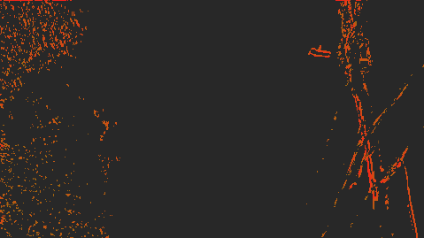
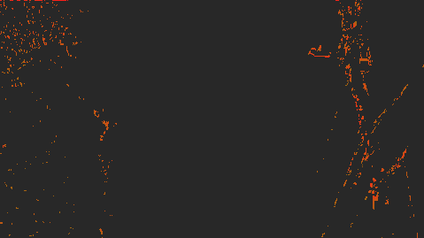
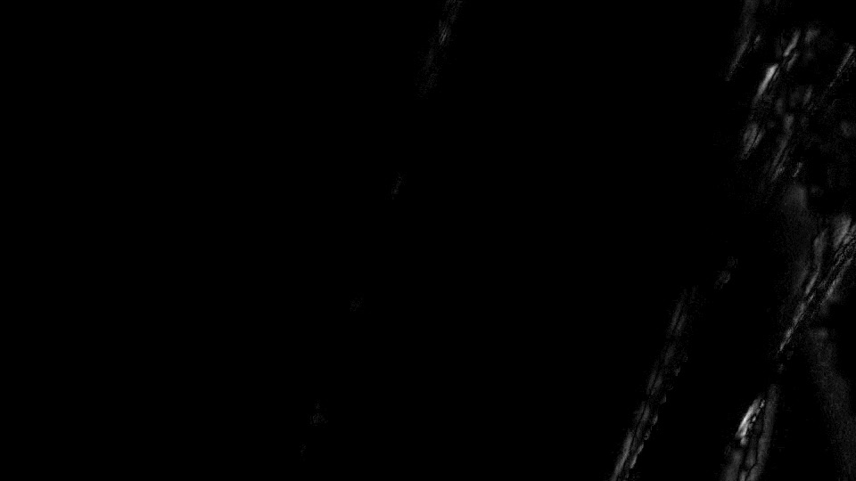
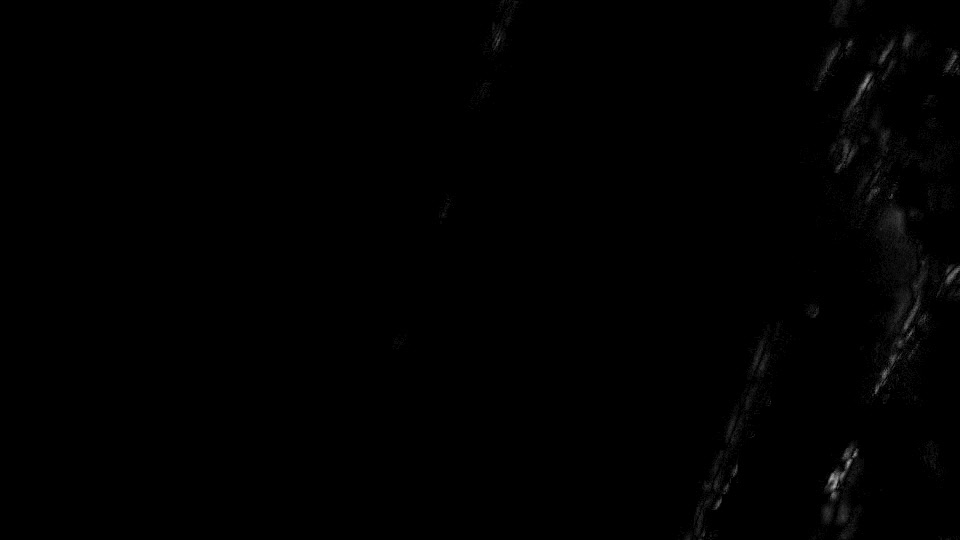

# MRecalculate smooth=2 (DTL2020 post_2.7.47_822) vs pinterf smooth=1

Full page with A/B viewer: [index.html](https://emcodem.github.io/mvtools/compare/dtl_smooth2/)

Clip: UHD 10-bit 4:2:2, pole and wires against sky (`seg1_wires_pole.mp4`). Chain as in our frame-rate converter:
MAnalyse 32/16 → MRecalculate 16/8, `thSAD=100, search=3, searchparam=2, truemotion=true, chroma=true`, pel 2 →
MFlowFps 24000/1001 `mask=2, ml=200`.

## Exact script

[scripts/avs/pinterf_sm1_flow.avs](scripts/avs/pinterf_sm1_flow.avs), as run (smooth=1, our build = pinterf cdf04a5,
CPU path):

```
LoadPlugin("C:\dev\uconvert\dlls\LSMASHSource.dll")
LoadPlugin("C:\dev\uconvert\dlls\RgTools.dll")
LoadPlugin("C:\dev\mvtools\profile\build_m1\mvtools2.dll")
SEGFILE = "C:\dev\mvtools\profile\clips\seg1_wires_pole.mp4"
m = LWLibavVideoSource(SEGFILE, cachefile=SEGFILE + ".lwi")
pre = m.RemoveGrain(22)
supf = MSuper(pre, pel=2, hpad=16, vpad=16, rfilter=4, mt=false)
sup = MSuper(m, pel=2, hpad=16, vpad=16, rfilter=4, levels=1, mt=false)
bv = MAnalyse(supf, isb=true, blksize=32, overlap=16, search=3, searchparam=2, truemotion=true, chroma=true, mt=false)
fv = MAnalyse(supf, isb=false, blksize=32, overlap=16, search=3, searchparam=2, truemotion=true, chroma=true, mt=false)
bv = MRecalculate(sup, bv, blksize=16, overlap=8, thSAD=100, search=3, searchparam=2, truemotion=true, chroma=true, mt=false)
fv = MRecalculate(sup, fv, blksize=16, overlap=8, thSAD=100, search=3, searchparam=2, truemotion=true, chroma=true, mt=false)out = MFlowFps(m, sup, bv, fv, num=24000, den=1001, mask=2, ml=200, blend=false)
return out.Trim(18, 25)
```

(The missing line break before `out =` is in the file as run; AviSynth parses it as two statements.)

The other scripts in [scripts/avs/](scripts/avs) differ from this one only in:

| script | `LoadPlugin` mvtools2.dll | MRecalculate | last line |
|---|---|---|---|
| `pinterf_sm1_flow` | ours | default (smooth=1) | MFlowFps, frames 18–25 |
| `dtl_sm1_flow` | DTL c688008 | default (smooth=1) | MFlowFps |
| `dtl_sm2_flow` | DTL c688008 | `smooth=2,` after `thSAD=100,` | MFlowFps |
| `fix_sm2_flow` | DTL c688008 + patch | `smooth=2,` | MFlowFps |
| `*_vec` | as above | as above | `return Interleave(bv.Trim(10, -1), fv.Trim(10, -1), bv.Trim(50, -1), fv.Trim(50, -1))` |

Frames, crops, PSNR and maps: [scripts/render.ps1](scripts/render.ps1) (the ffmpeg commands as run; output file names
unified). The 5-format × 3-chain identity check: [scripts/cmp.ps1](scripts/cmp.ps1) + [scripts/cmp.py](scripts/cmp.py);
its MDegrain2 + MCompensate script: [scripts/avs/pinterf_degrain.avs](scripts/avs/pinterf_degrain.avs).

## 1. Same parameters: identical

DTL2020 `post_2.7.47_822` (c688008, built from source) and pinterf `cdf04a5` produce byte-identical output in 5 formats
(10/8 bit 4:2:2, 4:2:0, 10 bit 4:4:4) × 3 chains (MAnalyse+MRecalculate vectors, MFlowFps, MDegrain2+MCompensate).

## 2. smooth=2: search radius is never reset

`Sources/PlaneOfBlocks.cpp` (recalculate path) clamps the adaptive radius into the member `nSearchParam`:

```cpp
nSearchParam = std::clamp(adaptiveSearchParam, nSearchParam, RECALCULATE_ADAPTIVE_RADIUS_LIMIT);
```

`nSearchParam` is set once per frame and never restored, so within a frame the radius only grows: after the first
block with widely spread input vectors, every later block above thSAD searches with that large radius. With `mt=true`
the slices also race on it. Test fix: [smooth2_radius_fix.patch](smooth2_radius_fix.patch) (save and restore per block).

| changed vectors vs smooth=1 (of 128,851 blocks) | bv f10 | fv f10 | bv f50 | fv f50 |
|---|---|---|---|---|
| smooth=2 as released | 4,666 | 2,981 | 4,421 | 4,277 |
| smooth=2 radius fixed | 1,929 | 1,636 | 426 | 810 |

Changed blocks, bv frame 10 (left: released, right: fixed). Grey = same vector, amber→red = larger change:

 

MFlowFps PSNR against smooth=1, interpolated frames 1–8 (inf = same frame):

| | 1 | 2 | 3 | 4 | 5 | 6 | 7 | 8 |
|---|---|---|---|---|---|---|---|---|
| released | 57.52 | 59.00 | inf | 58.27 | 57.31 | 57.60 | inf | 57.34 |
| fixed | 60.23 | 63.01 | inf | 61.65 | 61.43 | 61.93 | inf | 61.23 |

## 3. Still worse than smooth=1 on thin structures

Every changed block has a lower SAD than with smooth=1, but on the wires a radius of ~20 px finds a neighbouring wire
or a piece of sky with a lower SAD: a good pixel match, not the true motion. MFlowFps then bends the wires in the
interpolated frames. smooth=1 only refines ±2 around the interpolated coarse vector and stays coherent.

Interpolated frame 5, crop 960×540 at (2880, 240): smooth=1 / smooth=2 released / smooth=2 fixed

  

Difference to smooth=1 ×12, released / fixed:

 

Note: the radius is computed from vector differences in sub-pel units (see the "are we need to scale by nPel ??"
comment), so at pel 2 it is twice the pixel distance.
