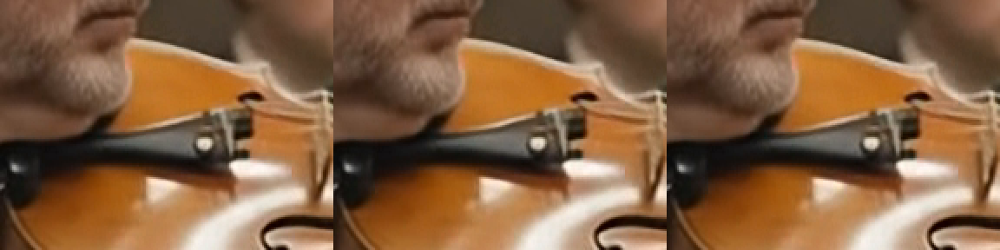
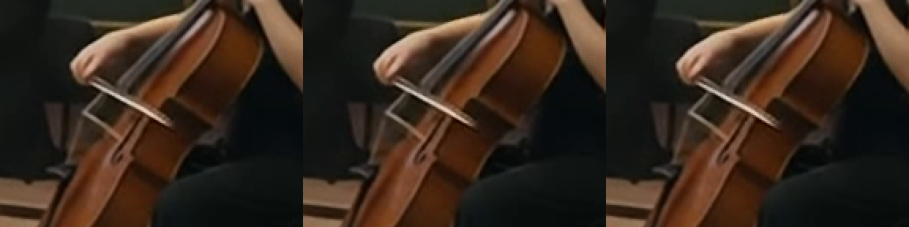
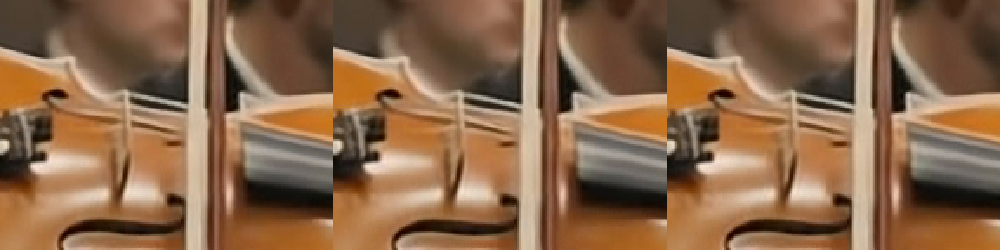
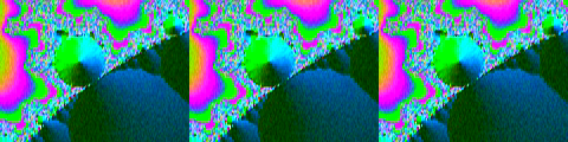
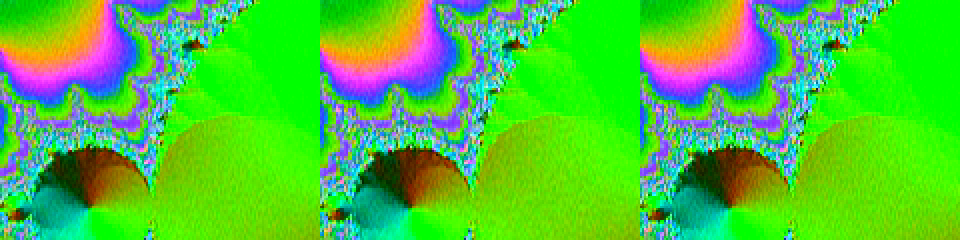
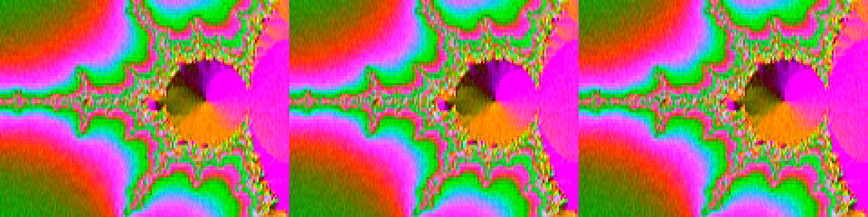
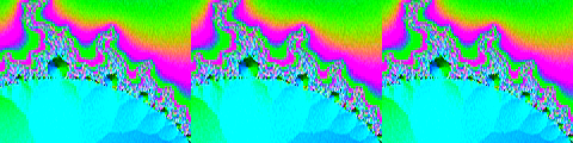

# NVENC / D3D12 ME with colour: DTL's three-channel proposal (prototype, 2026-11-14)

> **Status 2026-11-14: the mechanism works, the gain on real footage is small, and NVENC stays far behind NVOFA.**
> One grey ME run per channel (Y, U, V or R, G, B) plus per-cell selection by the full-colour SAD finds motion that is
> only in the chroma: 88-93 % of the blocks are right, against 0 % for luma-only, through the NVENC SDK and D3D12 alike.
> On seg1_wires_pole, though, the skip-frame test gains 0.2-0.7 dB at most. Most of that gain comes from the selection
> step itself: a luma-only run choosing among its 8 neighbours by colour SAD (the `ynb` control) gets about as far. Every
> variant has 5-7x NVOFA's count of bad blocks. Not judged by eye.
> Further levers ([below](#further-levers-nvenc-sdk-p4-same-tests-2026-11-14-evening)): QP and smoothing trade accuracy
> for coherence. The best is luma + a swapped run at QP 10, which beats the exact search in the skip-frame test. For old
> cards NVENC is a speed question, which needs a Pascal / Turing card.

DTL's proposal (doom9, 2026-10-31): NVENC's ME ignores chroma (measured in [compare/nvencme_frc](../nvencme_frc/README.md)
through the NVENC SDK and through D3D12). So the idea is to run it once per colour channel and keep, per block, the vector
with the lowest colour SAD. This is mode 8 of his `MAverage`. This folder tests that with the prototype filter
`NVENCMEProto` ([../nvencme_frc/proto/plugin.cpp](../nvencme_frc/proto/plugin.cpp)), switch `NVME_COLOUR`:

| `NVME_COLOUR` | ME runs per pair | candidates per 8x8 engine cell |
|---|---|---|
| (unset) | 1, luma | (none: the engine's vector) |
| `ynb` (control) | 1, luma | own cell + 8 neighbours = 9 |
| `yuv` | 3: Y, U, V (chroma at luma size) as grey pictures | 3 |
| `rgb` | 3: R, G, B (BT.709 limited) as grey pictures | 3 |
| `yuvnb` / `rgbnb` | 3 | 3 x 9 = 27 |

Selection: Y SAD x (chroma subsampling factor) + U SAD + V SAD of the 8x8 cell at integer pel (chroma at luma size, so
4:2:2 chroma weighs as in MAnalyse). Ties keep the earlier candidate (Y / R, own cell). After the selection, the same
per-block median of the cells under each 32/16 block as before. Both engines: `dx12=0` is the NVENC SDK, the target
because it also runs on Linux. `dx12=8` is D3D12, for comparison only (Windows; on Linux only through WSL).

Setup: RTX 5090, driver 616.92. seg1_wires_pole.mp4 (UHD 10-bit 4:2:2), uc_FRC chain as in nvencme_frc. MSuper,
MRecalculate, MFlowFps and MFlowInter are the CPU filters of the 2026-11-13 bundle (bit-identical to the GPU ones), and
NVOFA is `CudaNVOFAnalyse`. NVENC SDK runs use fresh sessions (deterministic).

## Synthetic: flat luma, texture only in U, shift (8, 4) px (`scripts/synth.py`, 1080p 4:2:2)

| | luma | `ynb` | `yuv` | `rgb` |
|---|---:|---:|---:|---:|
| NVENC SDK P4: blocks with the right vector | 0 % | 0 % | 87.5 % | 90.8 % |
| D3D12 8x8 | 0 % | 0 % | 92.7 % | 92.6 % |

## seg1_wires_pole

Coherence score (`scripts/prescreen.py`, as in nvofa_frc, lower = better), and the skip-frame test
(`scripts/skipcheck.py`). The skip-frame test computes vectors on the even frames and predicts each odd frame with
`MFlowInter(time=50)`, compared with the real frame: 8-bit, 16x16 blocks, error = mean abs Y + U + V; 75 predicted frames. It does
not reward coherence for its own sake, and it includes the colour planes.

| variant | score all | score tree | Y PSNR | U+V err | block p99 | p99.9 | blocks > 12 | > 24 |
|---|---:|---:|---:|---:|---:|---:|---:|---:|
| exact search | 0.038 | 0.032 | 37.33 | 1.155 | 20.2 | 36.6 | 91095 | 13898 |
| **NVOFA medium** | **0.009** | **0.011** | **43.10** | **0.933** | **10.1** | **23.2** | **16090** | **2180** |
| NVENC SDK P4 luma | 0.098 | 0.124 | 37.35 | 1.144 | 21.4 | 41.5 | 86169 | 17906 |
| NVENC SDK P4 `ynb` | 0.085 | 0.128 | 38.08 | 1.113 | 20.1 | 39.3 | 75308 | 15068 |
| NVENC SDK P4 `yuv` | 0.090 | 0.119 | 37.55 | 1.132 | 21.1 | 41.3 | 83484 | 17492 |
| NVENC SDK P4 `rgb` | 0.101 | 0.152 | 38.06 | 1.112 | 20.2 | 39.9 | 74864 | 15721 |
| NVENC SDK P4 `yuvnb` | 0.092 | 0.136 | 38.20 | 1.102 | 19.8 | 38.9 | 73606 | 14690 |
| D3D12 8x8 luma | 0.059 | 0.116 | 37.83 | 1.107 | 19.8 | 37.4 | 79281 | 13858 |
| D3D12 8x8 `ynb` | 0.067 | 0.128 | 37.99 | 1.100 | 19.7 | 37.3 | 77716 | 13667 |
| D3D12 8x8 `yuv` | 0.101 | 0.156 | 37.88 | 1.104 | 19.8 | 37.6 | 78852 | 13995 |
| D3D12 8x8 `rgb` | 0.088 | 0.157 | 38.32 | 1.087 | 19.3 | 37.3 | 72798 | 13104 |
| D3D12 8x8 `yuvnb` | 0.102 | 0.161 | 37.99 | 1.099 | 19.7 | 37.5 | 77520 | 13850 |

Which run won the cells (`NVME_STATS`, skip-frame runs, both directions): NVENC SDK `yuv` Y 89 % / U 8 % / V 3 %, `rgb`
R 74 / G 15 / B 12 %. D3D12 `yuv` Y 57 / U 24 / V 19 %, `rgb` R 45 / G 28 / B 27 %.

- **The colour runs change little on this clip.** The best variant (D3D12 `rgb`) is +0.5 dB and -8 % blocks > 12 against
  D3D12 luma. On the NVENC SDK, `ynb` (luma only, no extra ME run) is as good as `rgb` and close to `yuvnb`. The gain
  comes from choosing among more candidates by the real SAD, not from what the U / V runs see. The clip has little
  colour-only detail, so DTL's case (objects that differ in colour only) is not covered by it. The synthetic test shows
  that the mechanism handles that case.
- **Selection by SAD makes the fields less coherent** (higher score) while the predicted frames get slightly better.
  This is the encoder's own weakness (cheapest match per block) once more. MRecalculate does not undo it.
- **All NVENC-engine variants stay in the exact search's class** (blocks > 24: 13-18 k) and far from NVOFA (2.2 k).
  Colour does not close that gap.
- **Cost**: three ME runs per pair (UHD: NVENC SDK fresh session about 42 ms, D3D12 about 6 ms per run; nvencme_frc)
  plus a CPU SAD pass. Not timed here, because another benchmark was using the machine.

## Further levers (NVENC SDK P4, same tests, 2026-11-14 evening)

Switches: `NVME_QP` (constant QP, i.e. the encoder's λ for vector bits), `NVME_LAMBDA` (smoothness term in our
selection, SAD + λ·d²/256 with d in half pel to the 3x3 median of the luma run), `NVME_SWAP=1` (one more luma run with
the pictures swapped; its negated field adds candidates), `NVME_FBPEN` (penalty for candidates failing the
forward-backward check against that run), `NVME_TEMPORAL=1` (the previous pair's field, computed fresh, as 2 external
hints per macroblock; deterministic).

| variant | score all | score tree | Y PSNR | U+V err | blocks > 12 | > 24 | ME runs |
|---|---:|---:|---:|---:|---:|---:|---:|
| *exact search* | *0.038* | *0.032* | *37.33* | *1.155* | *91095* | *13898* | |
| *NVOFA medium* | *0.009* | *0.011* | *43.10* | *0.933* | *16090* | *2180* | |
| P4 luma (default rate control) | 0.098 | 0.124 | 37.35 | 1.144 | 86169 | 17906 | 1 |
| QP 10 | 0.176 | 0.237 | 37.78 | 1.117 | 78210 | 15818 | 1 |
| QP 30 | 0.097 | 0.115 | 37.21 | 1.154 | 89155 | 18528 | 1 |
| QP 38 | 0.081 | 0.075 | 36.70 | 1.185 | 100501 | 19340 | 1 |
| QP 44 | 0.052 | 0.037 | 36.18 | 1.211 | 111379 | 19443 | 1 |
| QP 51 | 0.029 | 0.013 | 35.55 | 1.245 | 126411 | 19586 | 1 |
| `ynb` λ 100 / 250 / 1000 (4000, 16000 = 1000) | 0.072 / 0.070 / 0.069 | 0.093 / 0.089 / 0.087 | 37.72 / 37.64 / 37.56 | 1.14 | 82842 / 83963 / 84664 | 16999 / 17260 / 17415 | 1 |
| `y` + swapped | 0.090 | 0.143 | 38.46 | 1.084 | 68463 | 13947 | 2 |
| `y` + swapped, fb penalty 1000 | 0.085 | 0.124 | 38.31 | 1.091 | 70194 | 14086 | 2 |
| **`y` + swapped, QP 10** | 0.144 | 0.221 | **38.67** | **1.070** | **64651** | **12491** | 2 |
| `y` + swapped, QP 38 / 44 | 0.075 / 0.053 | 0.089 / 0.041 | 37.64 / 36.83 | 1.13 / 1.17 | 83509 / 98474 | 16772 / 18078 | 2 |
| temporal hints | 0.104 | 0.136 | 37.76 | 1.128 | 80811 | 16477 | 2 |
| temporal hints, QP 38 | 0.087 | 0.086 | 36.88 | 1.174 | 96299 | 19070 | 2 |

(`NVME_QP=0` gave exactly the default result: constant QP 0 is apparently ignored.)

- **QP is a real knob of the engine, but it trades accuracy for coherence, all the way.** QP 51 reaches NVOFA-like
  coherence in the trees (0.013) with the worst predicted frames (35.6 dB, SAD 1983): smooth but wrong. QP 10 gives the
  best plain-luma frames, with the least coherent field. No QP is good at both.
- **Our smoothness term behaves the same**: more coherence, slightly worse frames; it saturates already at λ 1000.
- **The swapped run is the best single lever for accuracy.** With QP 10 it beats the exact search in the skip-frame
  test (12.5 k vs 13.9 k bad blocks, 38.7 vs 37.3 dB). In a filter that computes both directions it costs no extra ME
  run: the swapped run of (n, n-1) is the other direction's run of the pair.
- **Temporal hints** help a little (37.8 dB), not more than QP 10 alone.
- **Nothing gets near NVOFA** (2.2 k bad blocks, 43.1 dB). NVENC + MRecalculate lands in the exact search's class. For
  old cards (no OFA) that makes it a speed question: NVENC (2 runs per pair, fixed-function) against our CUDA exact
  search on the same card. Not measurable on the 5090; needs a GTX 10xx / 16xx / RTX 20xx.

## Known problems

- **HEVC ME-only (`codec="hevc"` / prototype `codec="hevc"`) gives zero vectors** on the synthetic shift test, in the
  prototype and in the plugin (RTX 5090, driver 616.92, NVENC API 13.0). Only H.264 is usable; cause not known.
- The smoothness term (`lambda`, `NVME_LAMBDA`) pulls towards the luma run, against colour-only motion.
- Kept encoder sessions are not deterministic under Prefetch; the plugin's `session="reset"` is.

## The plugin: nvencmv.dll / CudaNVENCAnalyse (2026-11-14 night)

The prototype's options as a real filter ([Documentation/nvencmv.md](../../Documentation/nvencmv.md)): grey pictures on
the GPU from the device frames, NVENC reads them in place, selection and block vectors on the GPU. Checks:
- With the prototype's settings (`qp=-1, swap=false`) the vectors equal NVENCMEProto's (100 % of the 32/16 blocks,
  4 frames checked); the chain scores are the same (37.35 dB).
- Synthetic flat luma + texture in U: `channels="yuv"` / `"rgb"` 85 % right (98 % with `half=true`), luma 0 %; HEVC
  0 % (zero vectors, as in the prototype).
- Deterministic: `session="reset"` gives the same md5 as `"fresh"`, stable over 3 runs with Prefetch(4); `"kept"`
  changes every run.

| variant (skip-frame test as above) | Y PSNR | U+V err | blocks > 12 | > 24 |
|---|---:|---:|---:|---:|
| `qp=-1, swap=false` (= prototype P4 luma) | 37.35 | 1.144 | 86170 | 17909 |
| defaults (QP 10, swapped run) | 38.64 | 1.073 | 64936 | 12543 |
| `channels="yuv"` (+ defaults) | **38.81** | **1.069** | **63771** | **12263** |

Speed, analysis only (bv + fv, 120 UHD frames, Prefetch(4), RTX 5090, indicative): NVOFA medium 1.51 s; NVENC one run
per pair 6.00 s with fresh encoders; defaults (2 runs per pair): fresh 13.04 s, reset 3.18 s, kept 2.09-2.15 s;
`channels="yuv"` (4 runs) fresh 27.1 s. CudaMAnalyse 32/16 measured 16.3 s in the same setup, which looks too slow
compared with earlier chain timings; not checked.

## QTGMC with NVENC vectors (2026-11-15)

`global QTGMC_gpu_nvenc = true` (new in `qtgmc/make_qtgmc_gpu.py`, extra arguments in `QTGMC_gpu_nvenc_args`):
QTGMC's MAnalyse calls take CudaNVENCAnalyse on the plain search clip (tokens); the rest of the GPU chain unchanged.
RTX 5090, everything else on the GPU (`QTGMC_gpu_on()`), Prefetch(4). Scripts: [scripts/qtgmc/](scripts/qtgmc/).

### Ground truth (`scripts/qtgmc/qtgt.py`)

SVT 1080p50 sequences (CrowdRun, ParkJoy, InToTree, DucksTakeOff, OldTownCross), first 80 frames, 8-bit 4:2:0,
interlaced TFF without vertical filtering (field n from frame n), QTGMC bobs back to 50p; output frame n vs source
frame n (frames 3..76). Y PSNR (dB) / 16x16 blocks with mean abs Y+U+V error > 8:

| preset, clip | exact (stock) | NVOFA medium | NVENC `qp=-1, swap=false` | NVENC defaults | NVENC `channels="yuv"` | NVENC `qp=30` |
|---|---|---|---|---|---|---|
| Fast, crowd | **32.82** / 130585 | 32.79 / 131084 | 32.62 / 138142 | 32.67 / 136128 | 32.69 / 134756 | 32.65 / 137344 |
| Fast, park | **31.28** / 206434 | 31.25 / 206501 | 31.09 / 210533 | 31.12 / 209308 | 31.15 / 208294 | 31.15 / 209321 |
| Fast, tree | **36.33** / 19908 | 36.27 / 21977 | 36.11 / 26172 | 36.24 / 17928 | 36.28 / **16735** | 36.13 / 26128 |
| Fast, ducks | 33.48 / 175898 | 33.64 / 70480 * | 33.64 / 70480 * | 33.57 / 84994 | 33.51 / 98930 | 33.63 / 73150 |
| Fast, town | **35.20** / 21198 | 35.15 / 22631 | 34.95 / 28640 | 35.04 / 26945 | 35.10 / 24859 | 34.97 / 27908 |
| Slower, crowd | **32.50** / 176883 | 32.29 / 179848 | 32.16 / 191144 | 32.15 / 191319 | 32.08 / 191975 | 32.18 / 191269 |
| Slower, park | **31.01** / 231926 | 30.85 / 232941 | 30.64 / 242314 | 30.59 / 243233 | 30.57 / 243367 | 30.68 / 241134 |
| Slower, tree | **35.96** / 98253 | 35.88 / 108661 | 35.67 / 126997 | 35.73 / 128949 | 35.63 / 131692 | 35.74 / 117967 |
| Slower, ducks | **33.06** / 254915 | 32.96 / 256825 | 32.63 / 298651 | 32.68 / 293095 | 32.62 / 294999 | 32.69 / 292011 |
| Slower, town | **34.97** / 31122 | 34.86 / 33044 | 34.78 / 37996 | 34.80 / 38900 | 34.68 / 47156 | 34.85 / 36601 |

\* Fast, ducks: NVOFA and NVENC plain give the same frames (only the first / last 3 frames differ): most likely QTGMC's
thSAD rejects all their vectors on the grainy water, so neither compensates, which "wins" here because the reference
keeps its grain. **Caveat for the whole table**: the reference is the grainy source, so less temporal smoothing scores
higher; DTL's pipeline (clean source + added grain) would avoid that.

- NVENC vectors in QTGMC are slightly but consistently worse than the exact search: -0.1..-0.5 dB, 5-30 % more bad
  blocks (Slower more than Fast); NVOFA sits between. Among the NVENC variants the differences are small (≤ 0.15 dB,
  no variant best everywhere); `channels="yuv"` is the best NVENC variant in Fast, not in Slower.

### Real material: wall time (`scripts/qtgmc/realcheck.py`, 200 source frames, whole GPU QTGMC chain, best of 2)

| clip, preset | exact (stock) | NVOFA medium | NVENC defaults | NVENC `channels="yuv"` |
|---|---:|---:|---:|---:|
| XDCAM HD 1080i, Fast | 2.54 s | **1.67 s** | 3.31 s | 5.21 s |
| XDCAM HD 1080i, Slower | 7.90 s | **3.05 s** | 7.52 s | 12.48 s |
| PAL 576i, Fast | 1.03 s | **0.86 s** | 1.43 s | 2.09 s |
| PAL 576i, Slower | 2.44 s | **1.42 s** | 2.73 s | 4.35 s |

SVT 1080p50, 80 frames: Fast exact 1.01-1.04 s, NVOFA 0.88-0.96, NVENC plain 1.01-1.08, defaults 1.22-1.25, yuv 1.61-1.66;
Slower exact 3.13-3.22, NVOFA 2.45-2.58, plain 2.83-2.88, defaults 3.24-3.38, yuv 4.07-4.22.

- **On the 5090 NVENC does not pay off in QTGMC**: the exact GPU search is cheap here, and every NVENC call costs an
  encoder run plus the reset run (`session="reset"`), plus one more pair with `swap`; with `channels="yuv"` four pairs.
  Only Slower (where the search is the biggest cost) gains a little with one run (plain 2.86 vs 3.16 s), at worse
  quality. NVOFA is faster and better on every count.
- The open question stays an old card (no NVOFA, weaker CUDA): there the exact search's share is larger. Untested.

### For the eye: where NVENC differs most from stock (crops 2x nearest: exact | NVENC defaults | NVOFA)

The 16x16 block with the largest mean difference NVENC vs exact (luma), one per 10 frames, top 3 per case. Not judged.

| | |
|---|---|
| XDCAM Fast f349 [](img/qtgmc_xdcam_Fast_spot1_f349.png) | XDCAM Slower f31 [](img/qtgmc_xdcam_Slower_spot1_f31.png) |
| XDCAM Fast f5 [](img/qtgmc_xdcam_Fast_spot2_f5.png) | XDCAM Slower f363 [](img/qtgmc_xdcam_Slower_spot2_f363.png) |
| PAL Fast f366 [](img/qtgmc_pal_Fast_spot1_f366.png) | PAL Slower f343 [](img/qtgmc_pal_Slower_spot1_f343.png) |
| PAL Fast f250 [](img/qtgmc_pal_Fast_spot2_f250.png) | PAL Slower f375 [](img/qtgmc_pal_Slower_spot2_f375.png) |

Largest block differences: XDCAM 5-8, PAL 11-12 (mean abs luma per 16x16 block, 8 bit).

## DTL's GTX 1060 test (doom9) does not show that Pascal uses chroma

His script compares `MShow(super, vec, showsad=true)` of the colour clip with that of `Tweak(sat=0)` through `Subtract`.
That difference is not zero even when both vector fields are identical, for two reasons:
1. MShow draws the vectors over the super clip's picture, so the colour and grey pictures differ in U / V anyway.
2. `showsad` shows the SAD, and with `chroma=true` (shader SAD, optSearchOption=5) that includes the chroma.

Also, `Tweak` clips luma to 16-235 by default (`coring=true`); on this clip it changes nothing (luma 39..150), but on
other material it can move vectors through the luma. A conclusive test compares the vector data itself (e.g. Interleave
of the two vector clips as rawvideo, as `scripts/prescreen.py` reads it) or uses the flat-luma probe above.

## Reproduce

Build the prototype: `..\nvencme_frc\proto\build.bat <nv-codec-headers include\ffnvcodec> dll`. Set `NVME_BUNDLE`,
`NVME_LSMASH` and `NVME_SEGFILE` (see `scripts/variants.py`). Python with numpy:
```
python scripts/synth.py <work>
python scripts/prescreen.py <work> --metrics-only
python scripts/skipcheck.py <work>          # NVME_STATS files per variant land in <work>
```
